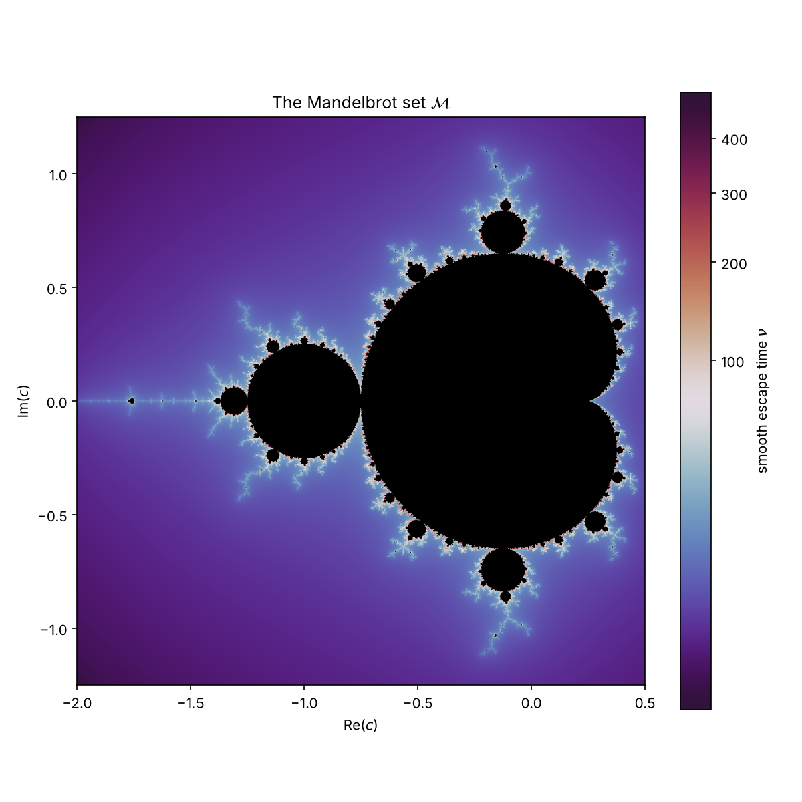
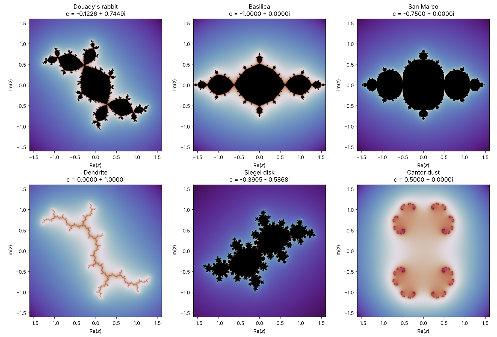

# Mandelbrot and Julia Sets with Python

A personal project where I program and plot the **Mandelbrot** and **Julia** sets of the polynomial

$$Q_c(z) = z^2 + c, \qquad c, z \in \mathbb{C},$$

using `numpy` and `matplotlib`. The goal is to connect the mathematics of complex dynamics with code that can be run, modified and visualised.

<p align="center">
  
</p>

## Contents

| File | What it does |
|---|---|
| [`mandelbrot.ipynb`](mandelbrot.ipynb) | Definition, escape criterion, smooth colouring, computation and regions to zoom into |
| [`julia.ipynb`](julia.ipynb) | Filled Julia set $K_c$ for any $c$, and a comparison of classic values |
| `images/` | Figures generated by the notebooks |

## Mathematical idea

- **Mandelbrot set:** $\mathcal{M} = \{c \in \mathbb{C} : (Q_c^n(0))_n \text{ is bounded}\}$, i.e. the values of $c$ for which the orbit of the critical point $0$ does not escape.
- **Filled Julia set:** $K_c = \{z_0 \in \mathbb{C} : (Q_c^n(z_0))_n \text{ is bounded}\}$, and $J_c = \partial K_c$.
- **Escape criterion:** if $|z_n| > R$ with $R \ge \max(2, |c|)$, then $|z_k| \to \infty$. It is used to decide when to stop iterating a point.
- **Relation:** $J_c$ is connected if and only if $c \in \mathcal{M}$.
- **Smooth colouring:** instead of the integer iteration count $N$ I use
  $\nu = N + 1 - \log_2(\ln|z_N|)$, which removes the colour bands.

The justification is explained inside each notebook.

## How to run it

```bash
git clone https://github.com/ocanalcu/mandelbrot-julia-fractals.git
cd mandelbrot-julia-fractals
pip install -r requirements.txt
jupyter notebook
```

Then open `mandelbrot.ipynb` or `julia.ipynb` and run the cells in order.

## Parameters you can change

Both notebooks have a **Parameters** cell:

- `x_min, x_max, y_min, y_max`: region of the plane to draw.
- `resolution`: pixels per side.
- `max_iter`: maximum number of iterations (increase it when zooming in).
- `cmap` and `gamma`: colours and contrast.
- In `julia.ipynb`, also `c`: the parameter of the polynomial (for example `c = -0.1226 + 0.7449j`).

## Results

Julia sets for different values of $c$ (Douady's rabbit, basilica, San Marco, dendrite, Siegel disk and Cantor dust):



## Limitations

- The results are **approximations**: with a finite `max_iter`, some points close to the boundary are classified as "inside" even though they eventually escape.
- With double precision you cannot zoom indefinitely (from scales of roughly $10^{-13}$ rounding causes pixelation).

## Possible extensions

- Estimate the dimension of the boundary of $\mathcal{M}$ by box counting.
- Plot the orbit of a given point and relate its behaviour to its position with respect to $\mathcal{M}$.
- Speed up the computation with `numba` and compare running times.

## References
- Notes of the subject Models Matemàtics i Sistemes Dinàmics (UB)
